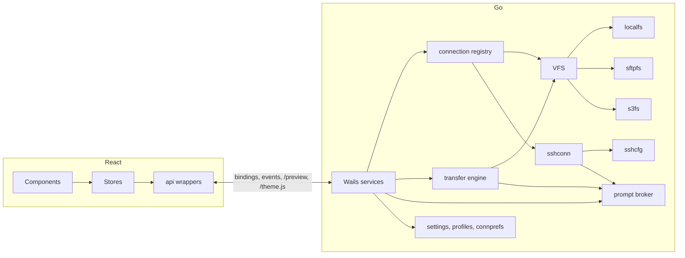

# Portunus design

This document describes how Portunus works today and why it works that way. It is for contributors. [AGENTS.md](../AGENTS.md) has the commands, conventions, and file-level map, and the [README](../README.md) has the user-facing features. When a design decision changes, change this file in the same pull request.

Portunus is a dual-pane file transfer client. Each pane shows local disk, an SFTP host, or an S3 bucket, and files move between any two panes. It is built on Wails v3, with a Go backend and a React frontend. macOS is the primary target and Linux is supported. Windows paths are handled in the code, but nobody has run the app there ([#82](https://github.com/w33ble/portunus/issues/82)).

## Architecture

- **Frontend.** Components read zustand stores. Stores call `frontend/src/api`, the only code that imports the generated bindings. It turns rejected calls into typed `AppError`s and exposes events with real types.
- **Services.** `internal/services` holds the Wails-bound services: `ConnectionService`, `FileService`, `TransferService`, `PromptService`, `SettingsService`, `VersionService`, and two HTTP handlers, `PreviewService` at `/preview` and `ThemeService` at `/theme.js`. They validate input and delegate. Logic lives in the packages below them.
- **Registry.** `services/registry.go` owns live connections, keyed by connection ID (`local`, `ssh:<alias>`, `ssh:<user@host:port>`, `s3:<profile id>`). Two panes on the same target share one connection.
- **VFS.** Every backend implements `vfs.FS`. The engine, the services, and the tests see only that interface.
- **Events.** The backend pushes `transfers:update`, `connections:changed`, `drop:files`, `nav:swipe`, and the `prompt:*` events. Each is registered with `application.RegisterEvent[T]`, so the TypeScript side gets generated types.
- **Errors.** `services.Classify` maps an error to a kind (`not_exist`, `exist`, `permission`, `unsupported`, `not_connected`, `hostkey_mismatch`, `canceled`, `other`). `MarshalError` sends `{kind, message}` as the rejection cause, and the frontend branches on the kind instead of the message.
- **Debug logging.** Wails logs bound-method arguments and results at debug level. `SaveS3Profile` takes a secret, so do not run debug logging in a build that touches real credentials.

## The virtual filesystem contract

`internal/vfs/vfs.go` defines `FS`: `Kind`, `Home`, `List`, `Stat`, `Open`, `Create`, `Mkdir`, `Remove`, `Rename`, and `Close`. The rules below apply to every backend.

**Paths.** Paths are absolute and `/`-separated on every backend, including local disk on Windows (`C:/Users/x`). Callers use package `path`, never `filepath`, and `vfs.FS` has no `Join`. S3 paths are `/` (the bucket list), `/<bucket>`, and `/<bucket>/<key>`.

**Listing.** `List` calls a `page` function with batches of entries, so a huge directory or a million-key S3 prefix renders as it arrives. Each batch is a fresh slice the receiver may keep. A symlink entry describes its target when the link resolves, as `ls -L` does, and `Entry.Link` holds the raw target. A dangling link has `IsDir` false and size 0.

**Staged writers.** `Create` returns a `Writer`. Nothing is visible at the target until `Commit`, and `Abort` (or a failed `Commit`) leaves no trace. Exactly one of the two is called.
- `Commit` refuses unless `Written()` equals `CreateOpts.Size` and returns `vfs.ErrSizeMismatch`. A file that changes size mid-copy fails the task instead of leaving a truncated file.
- `CreateOpts.Mode` and `ModTime` are applied at `Commit` where the backend supports them. S3 supports neither.
- `Open(offset)` returns an `io.ReadCloser`. Closing it aborts in-flight reads, which is how cancellation reaches backends that ignore the context. The transfer engine also aborts the writer from another goroutine on cancel.

**Remove and Rename.** `Remove` deletes one file, link, object, or empty directory. Recursion is a transfer-engine job, so a recursive delete has progress and can be canceled. `Rename` fails with `ErrExist` when the target exists and with `ErrUnsupported` where the backend cannot do it. The existence check is not atomic, so a concurrent writer can still be overwritten.

**Errors.** Backends wrap native errors so `errors.Is` matches `vfs.ErrNotExist`, `ErrExist`, `ErrPermission`, and `ErrUnsupported`. Code branches on those, never on message text. macOS permission errors in Documents, Desktop, and Downloads arrive as plain `ErrPermission` today ([#85](https://github.com/w33ble/portunus/issues/85)).

**Case.** A backend may implement `vfs.CaseInsensitive`. `localfs` does on macOS and Windows, and the engine then folds names when it matches conflicts.

### The copy loop

The engine never wraps both ends in a plain `io.Reader` and `io.Writer`. `pkg/sftp` pipelines requests only inside `File.WriteTo` and `File.ReadFrom`. A plain `io.Copy` with a 32 KiB buffer waits one round trip per packet, which caps throughput near 0.6 MB/s on a 50 ms link. The rule in `transfer/copy.go`:

1. If the source reader implements `io.WriterTo`, call it with a counting writer around the destination. A 4 MiB `bufio.Writer` sits in front, because `pkg/sftp` pipelines only writes larger than one packet.
2. Otherwise, if the destination writer implements `io.ReaderFrom`, call it with a counting reader around the source.
3. Otherwise, use `io.CopyBuffer` with a 1 MiB buffer.

### Local disk and SFTP staging

Both `localfs` and `sftpfs` stage a file as `.<name>.<12 random characters>.portunus-tmp` beside the target and rename it into place on `Commit`. The random part lets concurrent writers to one target each have a temp file, and the last rename wins. `localfs` hides names with the `.portunus-tmp` suffix from listings. If the app crashes, the leftovers are easy to find by suffix.

SFTP commits with `posix-rename@openssh.com` (`Client.PosixRename`). Plain SFTP rename fails on real OpenSSH when the target exists, because OpenSSH implements it with `link()`. When the server lacks the extension, `sftpfs` removes the target and then renames, and accepts the short non-atomic window. Other SFTP details:
- The mode comes from `CreateOpts.Mode`, or from the existing target when that is zero. Servers that refuse `setstat` keep their defaults.
- If the target is a symlink, the write goes through the link and replaces its destination. `localfs` does the same.
- If the directory refuses a temp file but the existing file is writable, `sftpfs` writes in place. That path is not atomic, and `Abort` cannot restore the old content.

### Symlinks

Listings show links. A copy follows a link to a file and copies the file it points to. It does not follow a link to a directory, which avoids loops, and it skips FIFOs, sockets, and devices because opening them can block forever. The skipped items show as skipped. A move on one connection renames such an item when its destination is free. A delete removes links and never follows them.

### S3

- **Virtual directories.** A prefix is a directory when any key lives under it. Listing uses `ListObjectsV2` with `Delimiter: "/"` and feeds each page to `List`. `Mkdir` writes an empty `<prefix>/` marker so empty directories survive, and `Mkdir` on `/<bucket>` creates the bucket.
- **Rename.** `Rename` is `CopyObject` plus delete, for one object of at most 5 GiB. Prefixes and larger objects return `ErrUnsupported`, and the engine falls back to copy and delete ([#73](https://github.com/w33ble/portunus/issues/73)). Service-specific features such as presigned URLs, storage class, and versioning are not built ([#74](https://github.com/w33ble/portunus/issues/74)).
- **Multipart writer.** `s3fs` has its own writer instead of the SDK's `feature/s3/manager`, which is deprecated, or `feature/s3/transfermanager`, which is still v0.x. An object smaller than one part uses a single `PutObject`. Otherwise the part size is 8 MiB, raised so `CreateOpts.Size` fits in the 10,000-part limit and never below 5 MiB.
- **Memory budget.** A writer holds at most four parts uploading and one filling, and never more than 256 MiB of buffers, so large parts mean fewer buffers. The cap applies per writer, not across concurrent transfers. Four parallel uploads can hold four budgets, and that is deliberate.
- **Abort.** `Abort` calls `AbortMultipartUpload` on a context detached from the transfer's, so a cancel cannot orphan an upload whose ID it never saw. A crash can still leave an incomplete upload, and the README does not yet document a lifecycle rule for them ([#86](https://github.com/w33ble/portunus/issues/86)).
- **Clients.** Bucket lists on AWS span regions, so `s3fs` keeps one client per region and finds a bucket's region from the `X-Amz-Bucket-Region` header of `HeadBucket`. Custom endpoints have one region and set `RequestChecksumCalculation` and `ResponseChecksumValidation` to `WhenRequired`, because many S3-compatible servers reject the SDK's default checksums.
- **Modification time.** S3 reports the upload time as the modification time. That is why `overwrite-if-newer` is not offered ([#75](https://github.com/w33ble/portunus/issues/75)).

### Why the conformance suite uses real servers

`vfs/vfstest` is one table of behaviors that every backend runs: paging, stat, open at an offset, commit over an existing file, abort leaving nothing, short writes refused, mode and mtime, rename, symlinks, and error mapping. `sftpfs` runs it against a real unprivileged OpenSSH `sshd`. The in-process `pkg/sftp` server renames with `os.Rename` and would hide the overwrite bug that `posix-rename` fixes. `s3fs` runs it against RustFS in Docker.

## SSH

### Host list and resolution

- **Host list.** `sshcfg.ListHosts` is a small scanner of our own. It understands only `Host` and `Include` (globs, `~`, relative paths, a depth limit of 16, cycles ignored) and ignores everything else, `Match` included. Host patterns containing `*`, `?`, or `!` are skipped. A missing file gives an empty list.
- **Why not `kevinburke/ssh_config`.** It fails on `Match exec` and most other `Match` criteria, and one such line would blank the host list for many real configs.
- **One resolver.** `ssh -G` is the only resolver for effective options (`sshcfg.Resolver`). Two resolvers that disagree on `HostName`, `ProxyJump`, or `UserKnownHostsFile` would be a security bug, so the app never parses options itself. It looks for `/usr/bin/ssh` first, because apps launched from Finder get a minimal `PATH`, and then searches `PATH`.
- **Quick connect.** A quick connect (`user@host:port`) also goes through `ssh -G`, with `-l` and `-p`. Without an `ssh` binary, config hosts are unavailable and a quick connect uses fixed defaults: `id_ed25519`, `id_ecdsa`, and `id_rsa` if they exist, `~/.ssh/known_hosts`, and a prompt for unknown keys.
- **Token expansion.** `ssh -G` does not expand most tokens. `sshcfg` expands `~` and `%h %p %r %u %n %d %C %l %L %i %%` in `IdentityFile`, `CertificateFile`, `UserKnownHostsFile`, `GlobalKnownHostsFile`, `IdentityAgent`, and `HostKeyAlias`. It drops identity files that do not exist (a private key or its `.pub` counts) and treats missing known_hosts files as empty. Tests compare against real `ssh -G` output.
- **Options honored.** `HostName`, `User`, `Port`, `IdentityFile`, `IdentitiesOnly`, `IdentityAgent`, `CertificateFile`, `HostKeyAlias`, `ProxyJump`, `UserKnownHostsFile`, `GlobalKnownHostsFile`, `StrictHostKeyChecking`, `HashKnownHosts`, `ConnectTimeout`, `ServerAliveInterval`, and `ServerAliveCountMax`.
- **Keepalive.** With no `ServerAlive*` options, `sshconn` pings every 30 seconds and closes the client after three misses. `pkg/sftp` ignores the context, so a dead link would otherwise hang a transfer.
- **Proxies.** `ProxyJump` works, including chains up to eight hops. `ProxyCommand` fails with `ErrUnsupported` instead of silently dialing direct ([#70](https://github.com/w33ble/portunus/issues/70)).
- **`PORTUNUS_SSH_CONFIG`.** This variable replaces `~/.ssh/config` for the host list and passes the file to `ssh -G -F`, which also skips `/etc/ssh/ssh_config`. The e2e run uses it.
- **Read-only config.** Hosts from `~/.ssh/config` are never copied into app data, and the app never edits that file. Saved SSH hosts are only remembered quick connects (name, user, host, port).

### Authentication

`golang.org/x/crypto/ssh` uses only the first instance of each auth method, so the agent and the key files must share one `publickey` method. `sshconn` registers one `PublicKeysCallback` that returns signers in this order:

1. Agent keys that match a configured `IdentityFile`.
2. File signers for configured identity files that are not in the agent.
3. Unless `IdentitiesOnly` is set, the remaining agent keys.

Default key files reach step 2 through `ssh -G`, which lists them as `IdentityFile`. After public keys come `keyboard-interactive` and then `password`, each retried up to three times. Details:
- **Lazy passphrases.** File signers get their public key from the `.pub` file or from `PassphraseMissingError.PublicKey`. The passphrase prompt fires inside `Sign()`, so it fires only if the server accepts that key. A wrong passphrase three times is fatal for the dial.
- **Agent-only identities.** An `IdentityFile` that points at a `.pub` file (the 1Password and Secretive pattern) means "use the agent key with this public key". `*_sk` security-key files are agent-only and need their `.pub`.
- **Agent socket.** `IdentityAgent` unset uses `SSH_AUTH_SOCK`, `none` disables the agent, and anything else is a socket path. Apps launched from Finder get launchd's `SSH_AUTH_SOCK` but not the shell environment, so the app reads no shell variables. It runs `ssh -G` and `~/.aws` lookups directly.
- **macOS keychain.** After a reboot, keys added with `ssh-add --apple-use-keychain` sit in the keychain but not in the agent. Before the first passphrase prompt of a dial, `sshconn` runs `/usr/bin/ssh-add --apple-load-keychain` once against the same socket and looks for the key again. The `loadAppleKeychain` setting controls it and defaults to on, because loading beats prompting.
- **Secrets are never saved.** Passwords and passphrases are not stored ([#76](https://github.com/w33ble/portunus/issues/76)). The agent already covers key passphrases.

### Host keys

Verification uses `skeema/knownhosts`, which wraps `x/crypto/ssh/knownhosts` and orders the offered host key algorithms by what known_hosts already holds. The lookup name is `HostKeyAlias` if set, otherwise `host` or `[host]:port`. The files read are `UserKnownHostsFile`, `GlobalKnownHostsFile`, and the app's own `known_hosts`.

- **Two-phase trust on first use.** A prompt must not race the server's `LoginGraceTime`. The first dial captures the unknown key in the host-key callback and aborts the handshake. The user is asked with no connection open. On accept, the key is appended (hashed if `HashKnownHosts` is set) and `sshconn` dials again.
- **Where keys are written.** The first writable `UserKnownHostsFile`, normally `~/.ssh/known_hosts`, so trust is shared with the `ssh` command. If that fails, `<config dir>/known_hosts`. The prompt says which file it will use. A configurable location is open ([#83](https://github.com/w33ble/portunus/issues/83)).
- **`StrictHostKeyChecking`.** `yes` rejects an unknown key. `no`, `off`, and `accept-new` record it without asking. Anything else prompts.
- **Mismatch.** A changed key is a `HostKeyMismatchError` with the file and line. It never becomes a prompt and has no override.
- **Redial after a prompt.** If the server drops the connection while the user typed a secret, `sshconn` redials once. Decrypted keys stay cached for the dial, so the user is not asked twice. Time spent in a prompt does not count toward the handshake timeout.

### Sessions

Each host has one SSH connection and two SFTP sessions on it. One session browses (`List`, `Stat`, `Mkdir`, `Remove`, `Rename`, `Home`) and one transfers (`Open`, `Create`, with concurrent writes), so a large transfer never delays a directory listing.

The registry makes connects single-flight per connection ID, and the dial runs on a context detached from the caller so one canceled pane does not fail a dial that another pane shares. When the transport dies, the registry forgets the connection and keeps the target. The next call to `FS` redials it once. `Reset` closes a connection and keeps the target, so editing an S3 profile makes panes redial with the new settings. `Disconnect` forgets both.

Servers without the SFTP subsystem are not supported ([#88](https://github.com/w33ble/portunus/issues/88)).

## Backend-to-UI prompts

Connecting and transferring need answers mid-flight. `internal/prompt.Broker` serves host keys, secrets, and file conflicts.

1. Go calls `AskHostKey`, `AskSecret`, or `AskConflict`. Each emits its own typed event (`prompt:hostkey`, `prompt:secret`, `prompt:conflict`) with an ID and then blocks.
2. The UI shows a dialog and calls `PromptService.RespondHostKey`, `RespondSecret`, or `RespondConflict`. A response with the wrong kind for an ID is rejected.
3. The broker emits `prompt:resolved` when a prompt is answered or dropped, so every view can dismiss it.
4. A canceled context or `Close` unblocks the asker.

`PromptService.Pending()` returns unanswered prompts, oldest first per kind. The frontend subscribes to events before it calls `Pending()`, so a reload or a late-mounted view cannot lose one.

**Per-job conflict gate.** For jobs with the `ask` policy, the first conflict prompts and every other conflicting task in that job waits in state `waiting`, holding no worker slot while other files keep copying. The user can overwrite, skip, or cancel the job. "Apply to all" with overwrite or skip answers every waiting and future conflict in the job.

## The transfer engine

`internal/transfer` runs copy, move, and delete jobs between any two `vfs.FS` values.

### Jobs and tasks

- **Job.** One user action, such as dropping N items from A onto B. A copy or move carries a conflict policy of `ask`, `overwrite`, or `skip`. Delete is a job too, so it has progress and can be canceled.
- **Task.** One file, or one directory to create, so empty directories survive. A producer goroutine walks directories depth first and feeds tasks to the scheduler as it finds them. The ready queue holds 64 tasks, which pauses the walk when workers fall behind, so a 100,000-file tree starts copying at once. Totals and ETA are provisional while `Walking` is true.
- **Conflict detection.** The walk lists each destination directory once and checks names against that listing. It makes no per-file `Stat` or `HeadObject`.
- **Input checks.** Source paths must be canonical and not the root. Entry names from a server are validated so a hostile server cannot write outside the destination. A directory cannot go inside itself.
- **States.** `queued`, `running`, `waiting`, then `done`, `failed`, `canceled`, or `skipped`. The `exhaustive` linter covers switches over them.

### Scheduling

`transfer.Limits` has `Global`, `PerConn`, and a `Conn` map of per-connection overrides. The defaults are 4 and 2, set in `settings.json`, with overrides from `connections.json`. `SetLimits` applies changes live. Lowering a limit below the running count lets running tasks finish and starts nothing new until the count drops under it.

A task needs the global permit plus one permit for each distinct connection it touches. The job keeps those connection IDs sorted, and the scheduler claims all the permits as a unit under the engine lock, or none. No task ever holds one permit while it waits for another, so remote-to-remote jobs in opposite directions cannot deadlock. Jobs dispatch oldest first, and a saturated connection does not block jobs bound for another.

The pool exists even at a limit of 1. Adding concurrency to a serial engine would mean rewriting progress, cancel, and conflict handling.

### Copying, cancel, retry, resume

- **Copy.** The copy loop above, then the `Written() == Size` check, then `Commit`. Any error or cancel calls `Abort`.
- **Cancel.** Canceling a job closes each source reader and aborts each destination writer, so backends that ignore the context still stop.
- **Retry.** `Retry` re-enqueues only the failed tasks. Failures that cannot succeed on retry stay in the failed list. The only automatic retry is the single SSH redial.
- **Resume.** A canceled job can resume. It walks its original sources again against the original destination, counts the paths that finished before the cancel without redoing them, and restarts in-flight files from byte 0. The job keeps its finished paths only while it is canceled. Resuming from the middle of a file is open ([#41](https://github.com/w33ble/portunus/issues/41)), although `Open` already takes an offset.

### Move

A move is the copy walker plus cleanup of the source.
- On one connection, an item with nothing at its destination is renamed. Directories are renamed in the walker and files as scheduled tasks. A failed rename, such as an S3 prefix or an object over 5 GiB, falls back to copy.
- Any other item is copied, and the source is deleted only after `Commit`. That deletion ignores cancellation, because stopping there would leave the file in both places.
- Replacing an existing file is a copy and a delete, never a rename over it.
- A directory is removed after everything inside it has moved. A skipped, failed, or canceled child keeps its parent.
- A retry copies again instead of trusting an earlier copy, and a resume asks again about conflicts that were skipped.

### Delete

A delete is a recursive job. A directory task waits until all its children are gone. A path that is already gone counts as deleted.

### Progress

Tasks update atomic counters. One aggregator goroutine is the only caller of `Emit`. Every 250 ms it emits a batched `transfers:update` with the jobs that changed and the IDs removed by `Clear`, and state changes request an earlier flush. Speed is an exponentially weighted moving average with a 3-second time constant, and ETA comes from that speed. Finished tasks collapse into per-job counters, so a 100,000-file job does not keep 100,000 rows. The job view lists only running and waiting tasks, and the first 200 failures.

### Not built

Queue persistence across restarts ([#77](https://github.com/w33ble/portunus/issues/77)), bandwidth limits ([#78](https://github.com/w33ble/portunus/issues/78)), and directory compare and sync ([#56](https://github.com/w33ble/portunus/issues/56)).

## Persistence and secrets

**Locations.** Portunus uses the XDG layout on every platform, macOS included. It does not use `os.UserConfigDir()`, which is `~/Library/Application Support` on macOS. `internal/appdirs` is the only code that resolves these paths, and it ignores relative `XDG_*` values as the spec says.
- Config is `$XDG_CONFIG_HOME/portunus`, else `~/.config/portunus`. It holds `settings.json`, `profiles.json` (S3 profiles), `connections.json`, and the fallback `known_hosts`.
- State is `$XDG_STATE_HOME/portunus`, else `~/.local/state/portunus`. It holds `state.json`, the main window's frame.

**Format.** There is one JSON file per concern, so a change to one never rewrites another. `internal/atomicfile` writes a temp file in the same directory and renames it, with mode 0600 in a 0700 directory, so a crash never leaves a half-written file. Files are read and written with `encoding/json/v2`, which treats field names as case-sensitive, rejects duplicate keys, and supports `omitzero`. It ignores unknown fields, so an older build reads a newer file. `connections.json` also keeps unknown top-level sections when it rewrites the file.

A corrupt `settings.json`, `profiles.json`, or `connections.json` stops startup with the parse error and does not reset to defaults. `state.json` holds disposable UI state, so an unreadable one is dropped.

**`settings.json`.** It holds transfer limits, `loadAppleKeychain`, hidden files, swipe navigation, and the theme. Missing or invalid values fall back to defaults, and limits are clamped to 1 through 32.

**`connections.json`.** `internal/connprefs` stores saved SSH hosts, per-connection preferences, and bookmarks, all keyed by connection ID. It is separate from `profiles.json` and covers every connection, not only SSH. Preferences are a color tag, favorite, open-at folder, transfer limit, hidden-files override, and picker visibility.
- A saved host's ID derives from user, host, and port through `connprefs.SSHConnID`, the one ID format that `services.targetID` also uses. Editing a host's address moves its preferences and bookmarks to the new ID.
- The open-at folder is always one of the connection's bookmarks. Removing that bookmark sends the connection back to its home folder.
- `ConnectionService.Saved` drops entries for connections that no longer exist, such as an alias removed from `~/.ssh/config`. When the config cannot be read, every `ssh:` alias counts as known, so a broken `Include` does not wipe preferences.

**Window state.** `state.json` stores the window's normal frame, the size and position it has when it is neither maximized nor fullscreen, plus the maximized flag. Saves are debounced by 500 ms and also happen on close. Tracking only the normal frame means a maximized quit restores maximized, and un-maximizing returns to the old frame. Fullscreen is never restored. On launch, a saved frame that is mostly on a connected screen is reused, with its size capped to that screen's work area. Otherwise the window is centered on the primary screen. First launch is 1280 by 800. Wayland compositors place windows, so only the size is saved there. Restoring panes and their folders is open ([#84](https://github.com/w33ble/portunus/issues/84)).

**Secrets.** S3 secret access keys live only in the OS keychain, through `zalando/go-keyring` (Keychain on macOS, Secret Service on Linux), under the key `s3:<profile id>`. `profiles.json` never holds them. If the keychain is unavailable, `profiles.FallbackStore` keeps the key in memory for the session, and the connection manager says so. S3 profiles that use an AWS shared profile read `~/.aws` and store no secret. Passwords and passphrases for SSH are never stored ([#76](https://github.com/w33ble/portunus/issues/76)). Import and export of settings is open ([#87](https://github.com/w33ble/portunus/issues/87)).

## Frontend

The frontend is React 19 and TypeScript on Vite. State is in zustand stores, file lists are virtualized with `@tanstack/react-virtual`, and styling is plain CSS Modules over theme tokens, with no Tailwind.

**Startup.** `stores/bootstrap.ts` subscribes to events first, then loads the `Jobs`, `Pending`, and `Connections` snapshots. A reload therefore loses nothing. Panes open independently of the other loads, so a slow call such as reading `~/.ssh/config` cannot leave them blank.

**Listings are pulled.** `FileService.List` returns the first page and a cursor. `ListNext` returns the rest, and `ListClose` abandons a listing. On the Go side a producer goroutine hands pages over an unbuffered channel, so it reads ahead only as fast as the frontend pulls, and an idle cursor is reaped after 60 seconds. The pane store batches arriving pages every 60 ms, ignores pages from a stale `requestId`, and on refresh keeps the old entries on screen until the new listing completes. No event is needed for completeness, so a listing cannot be lost.

**Previews are an HTTP route.** The quick preview (Space) reads through `PreviewService`, an `http.Handler` mounted at `/preview` as `GET /preview?conn=<id>&path=<path>`. `` and the PDF viewer load the bytes directly, and nothing binary goes through JSON. When the cursor moves, the frontend aborts its fetch and the canceled request context closes the backend reader.
- The server sends the first 1 MiB of a text file and marks longer files with `X-Preview-Truncated`. Images over 20 MiB and PDFs over 50 MiB get no preview, and neither does a text file that fails an 8 KiB sniff for binary content. Both answer 204 with an `X-Preview-Reason` header.
- Text is always served as `text/plain` with a sandboxing `Content-Security-Policy`, so HTML shows as source.
- A preview uses only connections the registry already knows. It never dials a new target.

**Drag and drop.** Dragging between panes uses HTML5 drag and drop with the MIME type `application/x-portunus-entries`, which carries the connection ID and paths. The modifier picks the operation: Cmd on macOS and Shift elsewhere means move, and no modifier means copy. Drops from Finder use Wails `EnableFileDrop`. Elements marked `data-file-drop-target` receive them, and `App.HandleDrop` emits `drop:files` with the paths plus the `data-pane` and `data-path` of the target. Finder drops are always copies. Dragging files out of Portunus is not possible, because Wails has no drag-source API ([#62](https://github.com/w33ble/portunus/issues/62)).

**Connection catalog and picker.** `lib/catalog.ts` `buildCatalog` merges Local, `~/.ssh/config` aliases, saved hosts, S3 profiles, and preferences into one `KnownConnection` list, each marked `local`, `config`, `saved`, or `s3`. The picker shows favorites first, then Local, SSH hosts, and S3, and leaves out connections marked hidden unless the user asks. Local is never hidden. The picker is a custom popover (`ConnectionPickerPopover`) because it filters as you type, groups rows, and shows color tags, which a native select cannot do.

**Connection manager.** The manager edits a draft. Nothing is written until the user presses Save, and leaving with unsaved changes asks first. A bookmark added with ⌘D elsewhere updates an untouched draft. Saves go through `SaveSSHHost`, `SaveS3Profile`, and `SaveConnectionPrefs`. Anything from `~/.ssh/config` is read-only there.

**Bookmarks and recents.** Bookmarks persist in `connections.json`. Recent folders are session-only (`stores/recents.ts`, eight per connection) and are lost on quit. A saved connection must exist before its folders can be bookmarked.

**Layout.** The window has Browser and Transfers views with a status bar summary of active jobs and speed. Each pane has its own history. Multiple tabs per pane are open ([#72](https://github.com/w33ble/portunus/issues/72)), and so is editing a remote file in place ([#71](https://github.com/w33ble/portunus/issues/71)).

**Themes.** Themes are built in, and there are no user theme files. The setting is one choice: System, which follows the OS between Portunus Light and Dark, or a fixed theme. It is not a separate mode and theme. Each theme is a `[data-theme]` block of tokens. Palettes keep their upstream colors except where a token would miss WCAG AA contrast, and those tokens are lightened or darkened in place. The e2e contrast flow checks every theme.

The first paint is already themed. `index.html` loads `/theme.js` as a blocking script in `<head>`. `ThemeService` serves it with `theme.Script`, which sets `data-theme` on the root element. For System, the script chooses Light or Dark from `matchMedia` in the page, because only the page knows the OS appearance. After startup, `stores/theme.ts` `followTheme` keeps the attribute in step with the setting and the OS. `internal/theme` knows each theme's ID and background, and `main.go` uses it to color the native window behind the webview.

## Not built yet

Items with a link above are covered where they matter. The rest:
- Code signing and notarization ([#79](https://github.com/w33ble/portunus/issues/79)). The app is ad-hoc signed.
- Auto-update ([#80](https://github.com/w33ble/portunus/issues/80)).
- An AppImage ([#81](https://github.com/w33ble/portunus/issues/81)). The template script does not bundle GTK and WebKit.
