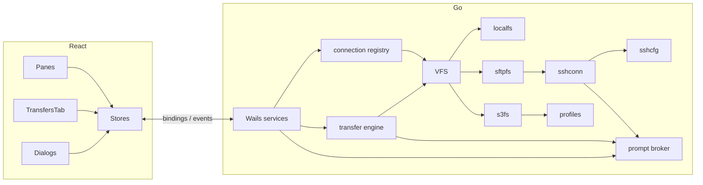

# Portunus MVP plan

Dual-pane file transfer client: local ⇄ SFTP ⇄ S3. Wails v3.1 (Go + React/TS).
Targets: macOS primary, Linux supported, Windows not tested but not excluded.

Reviewed by Claude Fable 5.2 (m2). Its findings are folded in below; the review is summarized at the end.

## Status

M0–M4 and M3.1 are implemented on `feat/mvp`. Every backend runs the shared VFS conformance suite against real servers (OpenSSH `sshd`, RustFS), and `mise run e2e` drives the real UI end to end in Wails server mode. M5 is partly done: macOS privacy usage strings are added, packaging hasn't been run.

Needs a real desktop (macOS first, then GTK4 Linux):

- Native window: hidden-inset titlebar drag region, traffic-light spacing, translucent backdrop.
- HTML5 drag between panes and onto folder rows in WKWebView/WebKitGTK. The e2e run drives Chromium, and Wails intercepts native drags.
- Finder/file-manager drops onto a pane (`data-file-drop-target` → `drop:files`).
- launchd `SSH_AUTH_SOCK` from a Finder-launched `.app`, `ssh-add --apple-load-keychain`, Keychain storage of S3 secrets, TCC prompts.
- `wails3 package` output (`.app`/`.dmg`, `.deb`/`.rpm`).

Deviations from the design below, all deliberate:

- No `Join` on `vfs.FS`: every backend uses absolute `/`-separated paths, so callers use package `path`.
- `vfs.FS.Remove` deletes one entry; recursive delete is a transfer-engine job.
- `sftpfs.List` reads the whole directory (pkg/sftp has no streaming readdir), then pages it to the UI.
- The S3 writer's memory cap is per writer, not shared across concurrent transfers.
- Copied directories get the destination's default mode; only file modes are preserved.
- Moves (F6, modifier-drag) are transfer jobs. On one connection they `Rename`; anything else, including overwriting an existing file and S3 prefixes, copies then deletes each source after its copy commits.
- `PORTUNUS_SSH_CONFIG` overrides the ssh config file for listing and `ssh -G -F` (used by e2e).
- The quick preview (Space) reads files through `PreviewService`, an `http.Handler` the asset server mounts at `/preview`, not a binding, so `` and the PDF viewer load bytes directly and nothing binary goes through JSON.

## MVP scope

In:

- Dual-pane browser. Either pane can point at any connection: local, SFTP host, or S3 bucket. Remote → remote (e.g. SFTP → S3) streams through the client at no extra design cost.
- SSH hosts come from `~/.ssh/config` (Include-aware). Auth uses ssh-agent, `IdentityAgent`, and keys in `~/.ssh`, falling back to keyboard-interactive/password.
- `known_hosts` verification (incl. `HostKeyAlias`) with a trust-on-first-use prompt; changed host key is a hard stop.
- Generic S3: AWS shared profile *or* static keys + custom endpoint/region/path-style. Fixed bucket, or bucket list with per-bucket region.
- Drag and drop: pane → pane (in-app), Finder/file manager → pane (OS drop).
- Transfers tab: queue, per-file + aggregate progress, speed/ETA, cancel, retry, clear finished.
- Concurrent transfers with configurable limits: fast follow (M3.1), designed in from the start.
- File ops: mkdir, rename, delete (with confirm), refresh, sort, multi-select, keyboard nav.
- Atomic writes: no half-written destination files on failure/cancel; size verified before commit.
- Unsigned `.app`/`.dmg`; Linux `.deb`/`.rpm` via nfpm.

Out (post-MVP, roughly by value):

- Resume interrupted transfers (`Open` takes an offset from day one so this is additive).
- Legacy SCP protocol fallback for servers without the SFTP subsystem. OpenSSH ≥ 9.0 `scp` already speaks SFTP, so this only matters for odd embedded targets.
- `ProxyCommand`. Hosts that use it fail with an explicit "unsupported" error rather than silently dialing direct. `ProxyJump` is in MVP.
- Edit-in-place (open remote file locally, re-upload on save), directory compare/sync.
- Multiple tabs per pane, bookmarks, recent paths.
- Service-specific S3 features: presigned URLs, storage class, versioning, R2/B2/MinIO quirks UI. Recursive S3 prefix rename and > 5 GiB object rename (`UploadPartCopy`).
- `overwrite-if-newer` conflict policy (S3 mtime is upload time, so it lies).
- Saving SSH passphrases/passwords to the keychain. The agent already covers key passphrases.
- Queue persistence across restarts, bandwidth limits.
- App → Finder drag-out: Wails has no native drag-source API. MVP offers "Download to…" instead.
- AppImage (template script doesn't bundle GTK/WebKit), code signing/notarization, auto-update, Windows QA.
- Configurable known_hosts write location (MVP: `~/.ssh/known_hosts`, app-private fallback only).

## Architecture



### Go packages

```
main.go                 Wails bootstrap only
internal/vfs            FS interface, Entry, error kinds, path helpers, conformance suite
internal/vfs/localfs
internal/vfs/sftpfs     github.com/pkg/sftp
internal/vfs/s3fs       aws-sdk-go-v2/service/s3 (own multipart writer)
internal/sshcfg         host list scanner + `ssh -G` resolver + token expansion
internal/sshconn        dial, auth, host key verification, ProxyJump, keepalive
internal/prompt         backend→UI prompt broker (host key, secret, conflict)
internal/profiles       saved S3 profiles + per-host app prefs; S3 secrets in OS keychain
internal/transfer       jobs, tasks, worker pool, permits, progress aggregation
internal/services       Wails-bound services (thin; no logic)
```

### The VFS contract

Everything pivots on one interface. Transfers, panes, and tests only see this. It must be settled in M1 because every backend implements it.

```go
type Kind string // "local" | "sftp" | "s3"

type Entry struct {
    Name    string
    Path    string      // absolute within the FS; '/'-separated except localfs
    Size    int64
    ModTime time.Time
    Mode    fs.FileMode // zero for s3
    IsDir   bool
    Link    string      // symlink target, empty otherwise
}

type CreateOpts struct {
    Size    int64       // expected bytes; S3 part sizing + pre-commit verification
    Mode    fs.FileMode // applied at Commit where supported (exec bit survives)
    ModTime time.Time   // applied at Commit where supported
}

type FS interface {
    Kind() Kind
    // List streams pages so a 1M-key S3 prefix or huge dir renders progressively.
    List(ctx context.Context, dir string, page func([]Entry) error) error
    Stat(ctx context.Context, p string) (Entry, error)
    Open(ctx context.Context, p string, offset int64) (Reader, error)
    Create(ctx context.Context, p string, opts CreateOpts) (Writer, error)
    Mkdir(ctx context.Context, p string) error         // MkdirAll semantics
    RemoveFile(ctx context.Context, p string) error     // single file/object/empty dir; recursion lives in the engine
    Rename(ctx context.Context, from, to string) error  // s3: single object ≤ 5 GiB only
    Join(elem ...string) string                         // filepath vs path vs key semantics
    Close() error
}

type Reader interface {
    io.ReadCloser // Close aborts in-flight reads; that's how cancel works when the backend ignores ctx
}

// Writer makes partial files impossible: nothing is visible at the target until Commit.
type Writer interface {
    io.Writer
    Written() int64 // Commit refuses if Written() != opts.Size
    Commit() error  // local/sftp: rename temp → target; s3: CompleteMultipartUpload / PutObject
    Abort() error   // local/sftp: delete temp; s3: AbortMultipartUpload
}
```

- Errors are wrapped into `vfs.ErrNotExist`, `vfs.ErrExist`, `vfs.ErrPermission`, `vfs.ErrUnsupported` so the UI can branch with `errors.Is` instead of parsing backend strings. On macOS, EPERM inside Documents/Desktop/Downloads maps to a "grant access in System Settings → Privacy" message.
- **Copy loop**: never wrap both ends in plain `io.Reader`/`io.Writer`. `pkg/sftp` only pipelines requests in `File.WriteTo`/`ReadFrom`; a plain `io.Copy` with a 32 KiB buffer does one round trip per packet (~0.6 MB/s at 50 ms RTT). Rule: if the source implements `io.WriterTo`, call it with a counting writer around the destination; else if the destination implements `io.ReaderFrom`, call it with a counting reader around the source; else `io.CopyBuffer` with a 1 MiB buffer.
- **Atomic commit on SFTP**: write `.<name>.portunus-tmp`, commit with `posix-rename@openssh.com` (`Client.PosixRename`). Plain SFTP rename fails on real OpenSSH when the target exists (it uses `link()`). If the extension is missing, remove + rename and accept the small non-atomic window. Preserve the target's existing mode on overwrite; if the target is a symlink, write through it. If the directory isn't writable but the file is, fall back to a direct write.
- **Symlinks**: listing shows them; recursive copy follows links to files but not to directories (no loops); recursive delete never follows links.
- **S3 specifics**: directories are virtual (`ListObjectsV2` + `Delimiter: "/"`, paginated into `page`). `Mkdir` writes a `dir/` marker. Multipart writer buffers parts and uploads them with bounded parallelism under a memory budget (`concurrent tasks × parts in flight × part size`, capped at ~256 MiB total). Part size comes from `opts.Size` so the 10,000-part limit holds. Small objects use a single `PutObject`. This avoids `feature/s3/manager` (deprecated) and `feature/s3/transfermanager` (still v0.x). Non-AWS endpoints set `RequestChecksumCalculation`/`ResponseChecksumValidation` to `WhenRequired`. Bucket lists on AWS span regions, so the s3fs keeps one client per bucket region (`GetBucketLocation`/`HeadBucket`).
- **Crash leftovers**: temp files carry the `.portunus-tmp` suffix (easy to find); README documents an S3 lifecycle rule for aborted multipart uploads.

### SSH config and auth

- **Host list**: a small tolerant scanner of our own that only understands `Host` and `Include` (globs, `~`, relative paths, depth limit) and ignores everything else, including `Match exec`. `kevinburke/ssh_config` is out: it hard-errors on `Match exec` and most `Match` criteria, which would blank the host list for many real configs. Patterns (`*`, `?`, `!`) are skipped; any host can still be reached with quick-connect `user@host:port`.
- **Effective options**: `ssh -G -F <config> <alias>` is the *only* resolver. Two resolvers disagreeing on `HostName`/`ProxyJump`/`UserKnownHostsFile` is a security bug. Use `/usr/bin/ssh` first on macOS (Finder-launched apps get a minimal `PATH`). No `ssh` binary → quick-connect only.
- **Post-processing `ssh -G`** (it does *not* expand most tokens): expand `~` and `%h %p %r %u %n %d %C %l %L %i %%` ourselves in `IdentityFile`, `CertificateFile`, `UserKnownHostsFile`, `IdentityAgent`, and `HostKeyAlias`. Drop default identity files that don't exist. Treat missing known_hosts files as empty. Fixture-tested against real `ssh -G` output.
- **Options honored**: `HostName`, `User`, `Port`, `IdentityFile`, `IdentitiesOnly`, `IdentityAgent`, `CertificateFile`, `HostKeyAlias`, `ProxyJump`, `UserKnownHostsFile`, `GlobalKnownHostsFile`, `StrictHostKeyChecking`, `HashKnownHosts`, `ConnectTimeout`, `ServerAliveInterval`/`CountMax` (default keepalive if unset: pkg/sftp ignores `ctx`, so a dead link would hang otherwise). `ProxyCommand` present → `ErrUnsupported`.
- **Auth** (`golang.org/x/crypto/ssh` uses only the *first* instance of each auth method, so agent and key files must share one `publickey` method):
  1. One `PublicKeysCallback` returning, in order: agent signers matching configured `IdentityFile`s, then file signers for configured `IdentityFile`s not in the agent, then (unless `IdentitiesOnly`) remaining agent keys and default key files.
  2. File signers are lazy: the public key comes from the `.pub` file or `PassphraseMissingError.PublicKey`; the passphrase prompt only fires inside `Sign()`, i.e. only if the server accepts that key. `IdentityFile` pointing at a `.pub` (1Password/Secretive pattern) means "use the agent key with this public key". `*_sk` files are agent-only.
  3. Then `keyboard-interactive`, then `password`.
- **macOS keychain keys**: after a reboot, keys added with `ssh-add --apple-use-keychain` are in the keychain but not the agent. Before the first passphrase prompt in a session, run `/usr/bin/ssh-add --apple-load-keychain` once (macOS only; setting, default on). That's the standard macOS setup, and it beats prompting.
- **Host keys**: `skeema/knownhosts` (wraps `x/crypto/ssh/knownhosts`, fixes host-key-algorithm ordering). Lookup uses `HostKeyAlias` if set and reads `UserKnownHostsFile`, `GlobalKnownHostsFile`, and the app-private `known_hosts`. TOFU is two-phase so prompts don't race the server's `LoginGraceTime`: dial, capture the unknown key, abort, prompt, append on accept (hashed if `HashKnownHosts`), reload, redial. Accepted keys go to the first `UserKnownHostsFile` (normally `~/.ssh/known_hosts`), sharing trust with CLI ssh; if that can't be written (missing `~/.ssh`, permissions, read-only managed file), they go to `<config dir>/known_hosts` (see Persistence) and the prompt says where. Mismatch → refuse, showing file and line; no override in MVP.
- **Connections**: one SSH connection per host, two SFTP channels on it: browsing and transfers, so large transfers can't stall listings. Connects are single-flight per host. If auth times out after a prompt, redial transparently once.

### Backend → UI prompts

Connecting and transferring need answers mid-flight. One broker for all of them:

1. Go calls `prompt.AskHostKey(ctx, …)`, `AskSecret(ctx, …)`, or `AskConflict(ctx, …)`. Each emits its own typed event (`prompt:hostkey`, `prompt:secret`, `prompt:conflict`, each registered via `application.RegisterEvent[T]` so TS gets real types) with an ID, then blocks.
2. The UI shows the dialog and calls `PromptService.Respond(id, answer)`.
3. `PromptService.Pending()` returns outstanding prompts, so a frontend reload or late-mounted view can't lose one.
4. Context cancel (user aborted, window closed) unblocks with `context.Canceled`.

Conflicts are gated per job: the first conflict in a job prompts; other conflicting tasks in that job wait on the gate rather than stacking dialogs. "Apply to all" resolves every waiting and future conflict in the job.

### Transfer engine

- **Job**: one user action (drop N items from A to B) with a conflict policy: ask / overwrite / skip. Delete and rename-of-dir are jobs too (recursive, cancellable, with progress), not blocking service calls.
- **Task**: one file *or* one directory to create, so empty directories survive. Directories expand lazily on a producer goroutine; a 100k-file tree starts copying immediately. Totals and ETA show "calculating…" until the walk finishes.
- **Conflict detection**: list each destination directory once and check names against it; no per-file `Stat`/`HeadObject`.
- **Worker pool from day one**: a global limit plus per-connection permits. A task acquires permits for both its source and destination connection, always in connection-ID order, to avoid deadlock on remote → remote. Lowering a limit below the running count lets running tasks finish; no new starts until under the limit. M3 ships with limits fixed at 1. M3.1 makes them configurable (default 4 global / 2 per connection). Retrofitting concurrency into a serial engine means rewriting progress, cancel, and conflict handling, so the pool exists from M3 regardless.
- **Copy**: per the copy-loop rule above, then `Written() == Size` check, then `Commit`; any error or cancel → `Abort`. Cancel closes the source reader and destination writer, so backends that ignore `ctx` (pkg/sftp) still stop.
- **States**: `queued → running → done | failed | canceled | skipped`, plus `waiting` (conflict gate). `exhaustive` lint covers switches over these.
- **Progress**: tasks update atomics; one aggregator emits a batched `transfers:update` every 250 ms (dirty rows only). State transitions emit immediately. Speed is an EWMA; ETA comes from that. Finished tasks collapse into per-job counters so a 100k-file job doesn't keep 100k rows in the UI.
- **Retry**: re-enqueue failed tasks only. No auto-retry in MVP beyond the single transparent SSH redial.
- **Resume**: a canceled job re-walks its original sources against the original destination, counts the paths that finished before the cancel without redoing them, and restarts in-flight files from byte 0. The job keeps its set of finished paths only while it is canceled.

### Frontend

- React 19 + TS + Vite, `zustand` stores (connections, panes, transfers, prompts), `@tanstack/react-virtual` for file lists. Styling: plain CSS modules with CSS custom properties for theme tokens (light/dark via `prefers-color-scheme`); no Tailwind.
- Pane = `{connectionId, path, entries, selection, sort}`; header has connection picker + breadcrumb path. Listings render page by page as the frontend pulls them: `FileService.List` returns the first page and a cursor, `ListNext` the rest, `ListClose` abandons one (idle cursors are reaped after 60s). Events are never needed for completeness.
- Drag pane → pane: HTML5 DnD with a custom MIME type carrying `{connectionId, paths}`; drop calls `TransferService.Start`. A pointer-event fallback is decided in the M1 spike if WebKit DnD misbehaves.
- Drag from OS: `EnableFileDrop` (already on in `main.go`) + `data-file-drop-target` on panes; the Go `WindowFilesDropped` handler gets absolute paths + target element details.
- Tabs: Browser | Transfers, with a status-bar summary (active count, aggregate speed) visible from the browser tab.
- macOS feel: hidden-inset titlebar, `⌘` shortcuts, native context menus via Wails menus.

### Persistence and secrets

- **Locations**: the XDG layout on every platform, macOS included (deliberately not `os.UserConfigDir()`, which is `~/Library/Application Support` on macOS). Folder names are lowercase; `internal/appdirs` is the only place that resolves them, and relative `XDG_*` values are ignored per the spec.
  - Config: `$XDG_CONFIG_HOME/portunus`, else `~/.config/portunus`: `settings.json` (concurrency limits, `ssh-add` behavior), `profiles.json` (S3 profiles, per-host prefs such as default remote dir), the fallback `known_hosts`.
  - State: `$XDG_STATE_HOME/portunus`, else `~/.local/state/portunus`: `state.json` (main window frame and maximised flag; pane state later).
  - The app isn't sandboxed, so macOS needs no permission prompts. A Mac App Store build would have to move into the sandbox container. No migration from the old `Application Support/Portunus`: there were no users.
- **Format**: one JSON file per concern, written atomically (temp file + rename, `internal/atomicfile`), parsed with `encoding/json/v2` (Go 1.27, no experiment flag): case-sensitive field names, duplicate keys are an error, `omitzero`, unknown fields ignored so older builds read newer files. SQLite is reserved for data that grows or needs querying (transfer history, persistent queue, recent paths), in its own file.
- **Window state**: saved on close and debounced (500 ms) on move/resize; only the normal frame is tracked (not while maximised or fullscreen), so a maximised quit restores maximised and un-maximising lands on the old frame. Fullscreen is never restored. On launch, a saved frame that is at least half visible (and whose title strip is reachable) is reused, size capped to that work area; otherwise the window is centered on the primary screen at the saved size, clamped to its work area. First launch is 1280×800 centered. Wayland compositors own placement, so only the size is saved and restored there. GTK4 emits no move event, so on Linux a pure move is only saved on close or with the next resize.
- SSH hosts are never copied into app config. `~/.ssh/config` stays the source of truth.
- S3 secret keys go to the OS keychain via `zalando/go-keyring` (macOS shells out to `/usr/bin/security`; Linux uses Secret Service over D-Bus; pure Go either way). Without a Secret Service, static keys are held for the session only, and the UI says so.
- Wails logs bound-method args/results at debug level. Never run debug logging in builds that touch real secrets; production builds discard these logs.

## Milestones

Each one ends with something runnable on macOS and Linux.

| # | Milestone | Done when |
|---|-----------|-----------|
| M0 | Scaffold | `mise run check` green *(done; GUI not yet launched, dev box is headless)* |
| M1 | VFS + localfs + dual-pane browser | VFS interface settled; browse/sort/select/mkdir/rename/delete-job on local FS in both panes; 50k-entry dir scrolls smoothly; DnD spike (HTML5 pane→pane + OS drop on WKWebView and WebKitGTK) decided; conformance suite passes for localfs; vitest on stores |
| M2 | SSH/SFTP connect + browse | Host list survives `Match exec`/`Include`; connect via agent, `.pub`-pointed agent key, encrypted key (lazy prompt), keyboard-interactive, password; two-phase TOFU + mismatch refusal; `HostKeyAlias`; ProxyJump; **Finder-launched `.app` connects via launchd agent**; conformance + auth matrix pass against a real unprivileged `sshd` |
| M3 | Transfer engine + Transfers tab | Pane↔pane DnD and OS drop; dirs (incl. empty) recurse; progress/speed/ETA; cancel leaves no partial files; overwrite on real sshd works; conflict gate with apply-to-all; retry; **≥ 10 MB/s on a 50 ms-RTT link for a single file**; engine tests pass under `-race` at limit 4 on a fake FS |
| M3.1 | Concurrent transfers (fast follow) | Global + per-connection limits in `settings.json` with a minimal control in the Transfers tab (default 4 / 2); many-small-files tree completes measurably faster than at limit 1; lowering a limit mid-run behaves as specified |
| M4 | S3 | Create profile (AWS profile or keys + endpoint); browse buckets (per-region clients) and prefixes; up/download incl. multipart under the memory budget; works against AWS and MinIO; conformance suite passes against MinIO |
| M5 | Polish + packaging | Keyboard shortcuts, error UX, settings screen, `.app`/`.dmg` (document "Open Anyway" on macOS 15+), `.deb`/`.rpm`, README |

## Testing

- **VFS conformance suite**: one table of behaviors run against every backend: list paging, stat, open-at-offset, create+commit, create+abort leaves nothing, **commit over an existing file**, short write refused at commit, mode/mtime preserved, rename, symlink handling, not-exist mapping.
  - localfs: `t.TempDir()`.
  - sftpfs: **real OpenSSH `sshd`** started unprivileged on a temp port with a temp config (`/usr/sbin/sshd` exists on macOS and most Linux). The `pkg/sftp` in-process server is only a fast pre-check: it renames with `os.Rename` and would hide the overwrite bug.
  - s3fs: **RustFS in Docker** (S3-compatible, replaces MinIO, whose Docker images are no longer maintained) for the integration lane. `gofakes3` only as a fast unit fake; it lacks `UploadPartCopy` and the AWS default-checksum upload path.
- **Auth matrix** (M2): in-memory agent on a temp socket, encrypted key + passphrase, `.pub`-pointed agent key, keyboard-interactive, ProxyJump through a second sshd.
- **sshcfg**: fixtures always passed with `ssh -G -F fixture` so tests never read the developer's real config; cover `Match exec`, `Include` globs, tokens, `HostKeyAlias`.
- **Engine**: fake FS with injectable latency/failure; cancel mid-file, conflict gate, retry, permit ordering, limit changes; run with `-race` at N > 1.
- **Frontend**: vitest for stores. Playwright UI tests can run headless against a Wails `-tags server` build later.
- **CI** (once a remote exists): lint + tests on Linux (`purego`), plus real cgo builds on macOS and Linux runners. `mise run check` only compiles `purego`, so the shipped binary needs its own job.
- **Manual QA** per milestone on macOS (primary) and Linux: real OpenSSH server, AWS S3, one S3-compatible (MinIO or R2).

## Risks

- **Linux build deps**: Wails 3.1 defaults to GTK4 + WebKitGTK 6.0 (`libgtk-4-dev libwebkitgtk-6.0-dev pkg-config build-essential`). The experimental `purego` backend skips headers and is used for lint/test only; don't ship it until proven.
- **WebKit DnD quirks**: HTML5 DnD + OS file drop on WebKitGTK and WKWebView, de-risked in the M1 spike.
- **macOS first run**: TCC prompts for Documents/Desktop/Downloads; Local Network privacy may gate LAN SFTP/MinIO from Finder-launched apps (unverified); ad-hoc signatures change per build, resetting grants. `Info.plist` usage strings get added in M2.
- **macOS environment**: Finder-launched apps get launchd's `SSH_AUTH_SOCK` but not shell env (`AWS_PROFILE`, custom `PATH`). Read `~/.aws/*` and run `ssh -G` directly; never rely on shell env.

## Decisions

1. **known_hosts**: write to `~/.ssh/known_hosts`; fall back to an app-private file when that fails. A configurable location comes later.
2. **macOS keychain**: run `ssh-add --apple-load-keychain` before prompting, on by default, with a setting to disable.
3. **Styling**: plain CSS modules. Tailwind can be added later if needed; removing it later would be harder.

## Review summary (m2, Claude Fable 5.2)

Wails API claims (file drop, `data-file-drop-target`, typed events, no drag-source API, GTK4 default) and S3 SDK package status were verified against source. Changes adopted from the review:

- **Blockers fixed**: SFTP overwrite via `posix-rename`; single `publickey` callback (x/crypto drops duplicate methods); `WriterTo`/`ReaderFrom` copy rule (plain `io.Copy` throttles SFTP); own host-list scanner (`kevinburke/ssh_config` rejects `Match exec`).
- **Should-fix adopted**: token expansion + `HostKeyAlias` + `ProxyCommand` refusal; two-phase TOFU, `Pending()`, single-flight connects, per-job conflict gate, typed per-kind events; paged `List`, `CreateOpts`, size verification, symlink policy, recursive ops as jobs, directory tasks, per-region S3 clients; race tests at N > 1 in M3, ordered permits, M3.1 config key, memory budget, counters for finished tasks, listing-based conflict detection; macOS first-run items and Finder-launched agent check moved into M2; real sshd + MinIO test lanes, auth matrix, `-F` fixtures, vitest, cgo CI.
- **Cuts adopted**: recursive S3 rename/`UploadPartCopy`, `overwrite-if-newer`, AppImage, keychain-saved SSH secrets.
